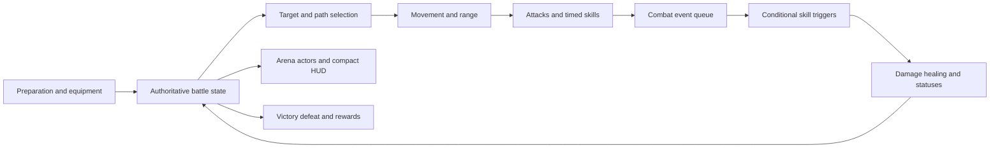

# Time Walker: Dark World — gameplay reverse engineering and rebuild blueprint

Analyzed November 1, 2026. Reference build: **1.0.0.16**, found both in the supplied folder name and in `globalgamemanagers`. Current project: Abyssal Echoes: Void Weaver, commit `b83dbd7`.

## Finding

The largest gap is the combat experience and the relationships between systems. Abyssal Echoes has menus, resources, rewards, and artwork, but its current battle is a stationary panel simulation. The reference presents four characters fighting in one navigable arena, with range, positioning, triggered skill combinations, explicit crafting, and visible combat contribution.

The next development milestone should be a small playable arena that proves positioning and two different builds matter. More icons, more classes, or a higher content count cannot establish those properties on their own.

## Evidence and limits

This investigation used:

- Read-only inspection of the supplied Unity installation: serialized assets, embedded JSON tables, script identifiers, and IL2CPP metadata.
- Resolution of the `ConfigManager` component in `level0` (object 236) to its actual table references in `sharedassets0.assets`. This matters because the package includes older/localized copies with different row counts.
- Inspection of seven official Steam screenshots covering character selection, combat, talents, and the EX recipe/merge interface.
- Comparison with the actual Godot scripts and resources, rather than the older project summaries.
- Official store information and developer announcements for corroboration.
- A later [sampled gameplay-recording review](YOUTUBE_GAMEPLAY_NOTES.md), with timestamped visual evidence and implementation refinements.

The reference launched successfully, but two attempts to capture its live window failed with `window capture timed out`. **No hands-on combat timing or input behaviour was verified.** Screenshot observations describe the public promotional build; they do not establish that every screen is identical in the installed version. Metadata establishes available components and fields, not the precise native implementation of each method. Exact damage formulas, targeting tie-breakers, collision behaviour, drop probabilities, and the active visibility of every data row remain unverified.

The files `NotebookLM_Study_Guide.md` and `Project_Summary_Archive.md` beside the reference describe an earlier React/mobile experiment. They are historical notes, not specifications for this Godot project or evidence of the reference game's exact rules.

## What was verified in the installed data

The build uses Unity **2021.3.1f1c1**, native `GameAssembly.dll`, and IL2CPP metadata version **29**. These are different from editable C# source files.

| Configured table | Object ID | Records | Interpretation |
|---|---:|---:|---|
| `characters_player` | 1570 | 28 | Character definitions across tiers, including internal/special entries |
| `skills` | 1616 | 366 | Behaviour rules including basic attacks, passive/internal rules, and player abilities |
| `props` | 1576 | 329 | Item definitions, including consumables, books, and ability items |
| `synthesis` | 1607 | 152 | Recipe records: 108 with three populated material fields, 43 with two, one nonstandard row |
| `buffs` | 1603 | 158 | Status and modifier records |
| `fetters` | 1575 | 79 | Composition-related records with character requirements and resulting skill references |
| `new_talent_details` | 1617 | 77 | Talent/unlock records with prerequisites and different reward types |
| `battle_difficuly_atlas` | 1591 | 8 | Difficulty/map configurations |
| `newshop` | 1604 | 7 | Shop progression configurations |

These are **data record counts**, not a claim of 366 equippable skills, 28 selectable characters, or 152 visible recipes. Unlocks, special entries, localization, and runtime filters affect what appears. The checked hashes and derived counts are recorded in [reference_facts.json](reference_facts.json). The raw asset tables remain in the local ignored analysis workspace.

## Reconstructed gameplay systems

### 1. A shared battlefield gives formation physical meaning

Official combat screenshots show characters occupying different positions in a common arena, projectiles travelling across it, health/status indicators above units, and a compact four-hero HUD along the bottom. Both teams participate in the same space. [Official combat image](https://shared.akamai.steamstatic.com/store_item_assets/steam/apps/2093910/ss_3a4724946b029dac894f82947a9315e02eb142af.1920x1080.jpg)

The installed metadata independently includes `HumanTileMovement`, `AStarManager`, path-selection and movement methods, attack-range updates, nearest-target selection, and a taunt plugin. Together with skill fields such as attack range, radius, target count, and origin type, this supports a movement/range architecture. It does not reveal every selection rule or pathfinding detail.

**Design consequence:** Starting positions affect who meets the enemy, how long an attacker travels, who can reach a vulnerable unit, and where area effects land. A larger arrangement grid is useful only when the simulation consumes those positions.

### 2. Abilities combine passive stats, triggers, and effects

The configured ability schema contains equipment modifiers, cooldown settings, targeting, attack geometry, status applications, and combat-resource conditions. The cumulative resource table names basic attacks, casts, hits, physical/magical actions, fire/ice actions, critical hits, evasion, healing done/received, and health thresholds.

For example, counter-based rows contain conditions that reference five basic attacks or several magical casts. Other rows use time-based cooldown fields. The presence of these fields, linked IDs, and update/listener metadata supports event-driven skill combinations; it does not prove every row is enabled.

**Design consequence:** An item can change the rate at which another item triggers, improve a character's ordinary attacks, or turn surviving damage into a benefit. A build changes combat behaviour and produces visible chains of cause and effect.

### 3. Crafting is an explicit build decision

The official merge screenshot shows material slots, a merge action, a recast action, and an EX recipe list over the arena. [Official crafting image](https://shared.akamai.steamstatic.com/store_item_assets/steam/apps/2093910/ss_451357bd4f66c71164c41ad811bb59d1848a7263.1920x1080.jpg) Configured recipes separately specify materials and a product. The store description also identifies advanced class items and EX combinations. The developer's December 8, 2023 update describes a quick-merge helper that starts when the player puts an ability into a merge slot. [Developer announcement](https://steamcommunity.com/games/2093910/announcements/detail/3887232925337997576)

**Design consequence:** Players choose when to sacrifice existing strength for an upgrade and can work toward a recipe. A crafting system needs a preview, validation, a safe transaction, and an accessible recipe browser. A random reforge is a separate decision from a known merge.

### 4. Character identity and build freedom coexist

The store advertises cross-class builds. [Official Steam description](https://store.steampowered.com/app/2093910/Time_Walker_Dark_World/) Local character definitions contain different stats, normal-attack references, related character IDs, and class tiers; the package also includes class-transfer and class-synthesis components.

**Design consequence:** Character identity can come from starting properties, a distinctive normal attack, a trait, or a class upgrade while allowing flexible skill equipment. Restricting every useful ability to one class narrows the combinations available to discover.

### 5. Rewards and progression feed build planning

The data separates loot configurations, weighted item pools, shop tiers, class unlocks, stat items, achievements, talent prerequisites, special events, and difficulty/room configurations. Public material describes choosing and upgrading a four-character party, managing loot, and spending persistent progression currency.

**Design consequence:** Rewards should help a player complete a plan, offer a tempting pivot, or force a resource tradeoff. The existence of a reward screen and a talent screen is only the framework for that experience.

### 6. The interface explains the battle without replacing it

The screenshots put the arena first. The persistent HUD groups a hero's identity, health, ability icons, statuses, and contribution figures. Crafting becomes a focused overlay. The character-selection screen exposes meaningful character statistics and signature abilities. [Official character-selection image](https://shared.akamai.steamstatic.com/store_item_assets/steam/apps/2093910/ss_b258edd9d4a14d947f29c2add31e532b086ccfde.1920x1080.jpg)

**Design consequence:** Art needs different jobs: small readable skill icons, recognizable character sprites, a readable arena, and attack-shaped effects. The newly generated icons are usable UI assets. Character motion and attack feedback still need their own implementation.

## Concrete gaps in Abyssal Echoes

| Priority | Current evidence | Effect on play | Proposed response |
|---|---|---|---|
| P0 | `BattleScene._set_hero_slot()` and drag/drop update `slot_index`; `BattleManager` reads a separate `position` value for front/back targeting. New heroes start at `(0, 0)`. | Rearranging a hero does not update the targeting coordinate. | Use a single authoritative combat position and derive display placement from it. |
| P0 | `BattleManager._do_basic_attack()` picks a random opponent. There is no combat movement or range check. | A frontline cannot physically intercept enemies; an archer's reach has little meaning. | Introduce a shared arena with target selection, movement, and range. |
| P0 | Hero resources advertise traits, but battle code does not consume `trait_effect_id`. | Taunt, piercing, healing aura, and every-third-cast claims do not establish their advertised identities. | Implement and verify each retained trait, then make descriptions reflect the real behaviour. |
| P0 | A baseline Cleric has healing power `1.5`; Heal multiplies it by `1.5` and converts to an integer. | The baseline heal restores **2 HP** before any relevant modifiers, against triple-digit health pools. | Establish explicit healing units and sensible test targets; validate effective healing rather than just execution. |
| P1 | Heroes roll a 60% skill-use chance, then choose a random available skill. | Builds often differ by damage values rather than a controllable sequence of interactions. | Separate timed actions from counter/condition-triggered passives. |
| P1 | Cooldowns decrease when a unit acts, although data calls them ticks. | Speed changes the effective meaning of cooldown values. | Define duration and cooldown units explicitly; use separate action counters where intended. |
| P1 | Manual skill drops allow cross-class equipment, while auto-equip filters `compatible_classes`. | The same item behaves differently depending on the equipment path. | Put eligibility and slot limits in one shared equipment API. |
| P1 | `RunState.check_for_merges()` automatically merges inventory triples; `MergeSystem` has no gameplay callers. | The player cannot use an explicit crafting workflow or act on its previews. | Add a manual recipe/merge tray and make it the authoritative crafting route. |
| P1 | There are 35 skill resources: 10 tier I, 10 tier II, 15 tier III, **zero tier IV**. | EX crafting code has no EX content to produce. | Implement a small validated set of EX recipes after the base build loop works. |
| P1 | Most skill effects are single damage/healing/status operations; synergies primarily count skill types per hero. | Few combinations change how a character fights. | Add a small set of complementary triggers, effects, and meaningful conditional bonuses. |
| P1 | Combat is displayed as two grids of large panels with moving square skill pictures. | The main screen communicates a dashboard rather than a battle taking place in a world. | Move combat into a shared arena; retain icons in the HUD and use readable attack effects in the world. |
| P2 | Four of six hero resources have no starting skills; class traits are mostly descriptive. | Early differences between several heroes rely heavily on basic stats. | Give each retained role a working starting pattern and a clear strength/weakness. |
| P2 | Difficulty affects the run's coin multiplier but is not used by current enemy creation. | The saved difficulty setting does not establish distinct combat challenges. | Connect authored encounter difficulty to the selected mode and expose its rules. |
| P2 | The manager has a speed setter, but the current battle UI does not call it. | The useful pacing control is unavailable despite being described in project notes. | Add visible speed and pause controls when the arena slice is ready. |

The older PRD contains pending features that the status file later treats as complete. The existing automated suites prove artwork integration and reward/save behaviour; they do not prove tactical depth, class identity, build interactions, or overall fun. The project should be tracked as a playable prototype with these remaining acceptance criteria.

## Proposed architecture for the Godot rebuild

This is a new implementation plan derived from the findings. It is not a claim about the reference game's exact source architecture.

| Component | Responsibility |
|---|---|
| Battle state | Own positions, health, targets, timers, action counters, statuses, and battle RNG |
| Arena navigation | Own walkable cells, occupancy, attack positions, path requests, and range queries |
| Combat action system | Choose legal actions; keep basic attacks, timed skills, and event triggers distinct |
| Combat event queue | Record completed actions once; resolve triggered effects with limits against self-triggering loops |
| Skill resources | Declare passive modifiers, activation conditions, targeting, and effects in explicit units |
| Arena actors | Display locomotion, facing, anticipation, impact, health, and status feedback |
| Battle HUD | Show four heroes, equipped icons, cooldown/trigger progress, speed/pause, and useful contribution data |
| Equipment service | Validate capacity and eligibility consistently for drag/drop, auto-equip, and saved loadouts |
| Crafting service | Validate ingredients and previews, then commit removals/additions atomically |

Suggested skill structure: `passive_modifiers`, `activation_type`, `cooldown_seconds`, `trigger_event`, `trigger_count`, optional `condition`, `target_rule`, and an `effects` list. Existing artwork and skill IDs can remain associated with the new definitions.

Simulation proposals such as a fixed 20 Hz update, melee range of one cell, or a longer archer range are **our tuning choices**, not recovered reference constants. Start with simple readable geometry and measure it before adding sophisticated navigation.

## First playable milestone

### A. Make the battle contracts true

Keep current saves and the menu/map/reward flow. Establish authoritative placement, living/dead state, coherent cooldown units, working healing, and three clear class identities. Add targeted tests for those behaviours. Connect equipment paths through one API.

Exit criteria: changing a starting position changes the first engagement in a designed fixed-seed scenario; a dead unit cannot take an action; the healer produces meaningful effective healing; the selected class traits actually trigger.

### B. Build one shared arena beside the existing battle scene

Create a separate arena scene so it can be reviewed before replacing the current route. Use four heroes and a few recognizable enemies, movement toward valid attack positions, a melee/ranged distinction, and a compact bottom HUD. Keep character rendering separate from simulation.

Exit criteria: a viewer can identify the tank, ranged attacker, healer, current targets, damage, and deaths without opening the combat log. A tank placed forward meets melee attackers earlier; a ranged attacker can attack without occupying melee range.

### C. Prove two builds

Use a small authored set rather than expanding to the reference's record count. Example original build directions:

- **Ember volley:** repeated basic attacks charge a fire projectile; burning enemies make a follow-up explosion stronger.
- **Bulwark recovery:** blocking or receiving hits charges a protective effect; healing contributes to a separate defensive trigger.

Keep trigger counters visible. Prevent an effect from recursively triggering itself without a deliberate rule. Use a fixed seed for comparison and attribute output to its source skill.

Exit criteria: swapping the key build item produces a visibly different action pattern and measurable result, not only a higher aggregate attack number.

### D. Add explicit crafting and a short run

Support one clear triple-to-upgrade recipe and one specific two-ingredient EX recipe. Keep random recasting a separate operation with its own input validation and output pool. Show ingredients, the result or possible pool, missing materials, and a confirmation action. Keep equipped items intact unless the player explicitly includes them. Make capacity and failure handling part of the transaction. A preview must remain consistent with the eventual transaction; the current random preview and execution paths need revision before use.

Author a short sequence that introduces equipment, grants a realistic opportunity to complete the first merge, tests positioning against a different threat, and ends with a boss. Tune the number and length of rooms after playtesting; a five-minute enjoyable loop is the quality target, not a recovered reference duration.

Exit criteria: the player can explain a build goal, make at least one meaningful crafting decision, observe why it helped or failed, and reach a clear conclusion with a useful summary.

## What to preserve

Keep the new skill artwork, resource-driven content, working save/reward checkpoints, inventory interaction concepts, and most high-level scene routing. Reuse their interfaces where appropriate. The arena, class behaviour, skill triggering, and crafting experience need the substantive work.

An exact pixel-art match is optional. Consistent character sprites, legible motion, restrained effects, and a coherent HUD matter more than matching the reference's asset count or copying its individual designs.

## Remaining verification work

1. Sampled recording evidence now covers preparation, loot, combat presentation, the crafting tutorial, and shop layout; see [video notes](YOUTUBE_GAMEPLAY_NOTES.md). Verify those interactions hands-on in the installed build when capture is available.
2. Measure movement, attack timing, initial skill cooldowns, and target switching in controlled situations.
3. Verify equipment-slot and class-token restrictions directly; screenshots can mix class, exclusive, and equipped ability slots.
4. Verify what the installed build exposes from the configured data. The shipped package contains hidden/internal records and older translations.
5. Inspect loss/revival, shop progression, difficulty effects, and recipe availability over a real run.

No original game files were patched. No reference source code or art was added to the Godot runtime. This session produced analysis and a build plan; it did not replace the combat implementation.

## Public sources

- [Official Steam store and screenshot gallery](https://store.steampowered.com/app/2093910/Time_Walker_Dark_World/) — four-character party, cross-class equipment, resource management, advanced class items, and EX combinations; screenshots inspected November 1, 2026.
- [Publisher description on Nintendo](https://www.nintendo.com/us/store/products/time-walker-dark-world-switch/) — corroborates the high-level loop. Its advertised skill count differs from Steam, so these counts were not treated as interchangeable version evidence.
- [Developer's 1.0.0.11 quick-merge announcement](https://steamcommunity.com/games/2093910/announcements/detail/3887232925337997576) — manual merge-slot workflow and a quick-merge helper; retrieved through Steam's announcement feed when the public page did not render its body.
- [Version 1.0.0.16 announcement thread](https://steamcommunity.com/app/2093910/eventcomments/4040355763639091728/) — dated December 13, 2023. Later endless-mode announcements were excluded from the installed-build baseline.
- [UnityPy project documentation](https://github.com/K0lb3/UnityPy) — analysis-tool usage only; no claims about gameplay were inferred from the tool's documentation.
